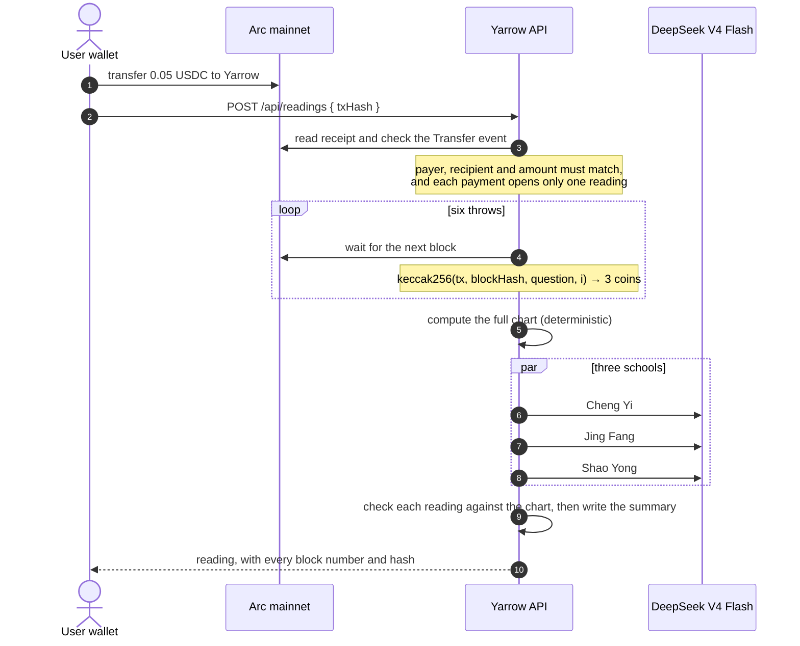
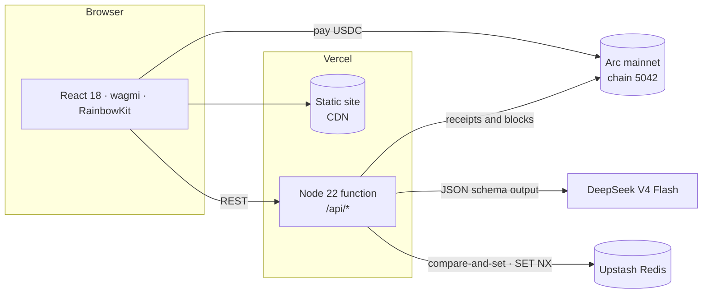

<div align="center">


# Yarrow · 三易

**Three classical masters read your fate. Arc makes the casting verifiable.**

*An I Ching and BaZi oracle on Arc mainnet. Every reading is paid in USDC, and every I Ching hexagram is cast from Arc block hashes.*

[](https://yarrow-six.vercel.app)
[](https://yarrow-six.vercel.app)
[](https://yarrow-six.vercel.app)
[](#tech-stack)

### [▶ Try it live: yarrow-six.vercel.app](https://yarrow-six.vercel.app)

**English** · [中文](README.zh-CN.md)


</div>

---

## Why Yarrow

For about three thousand years, people have consulted the *I Ching* by casting yarrow stalks or coins. Most online divination apps today just show text from a random-number generator, or let a language model invent the answer.

Yarrow works differently:

- **🎲 The casting can be checked.** Each I Ching coin toss is derived from your Arc payment and an Arc block produced after it. Anyone can recompute your hexagram, and Yarrow can't pick the result.
- **📐 The chart is computed, not imagined.** Hexagrams, Najia lines, the Four Pillars, luck cycles, Five Elements, the almanac and the Qimen board all come from deterministic code.
- **🏛️ Three masters, three methods.** Three historical schools read the same chart independently. You see where they agree and where they differ.
- **🔍 Every claim is checked against the chart.** Interpretations are audited against the computed chart before you see them. Statements the chart doesn't support are removed or rewritten.
- **💬 Plain language and practical advice.** A summary in plain language, steps you can act on, and things to avoid.
- **🌏 Bilingual.** Full Chinese and English interfaces. English readings are translated from the checked Chinese text, with a glossary for traditional terms.

## A look inside

<table>
<tr><td colspan="2">

**Life luck cycles.** Eight ten-year periods, scored independently by three BaZi masters. The line is their consensus and the whiskers show how far they disagree. Look back to see whether the past decades match your experience.


</td></tr>
<tr><td colspan="2">

**Annual influences.** Ten years around the year you ask about, with every clash, combination and harm between the year and your chart.


</td></tr>
<tr><td colspan="2">

**Combinations and clashes · Five Elements balance.** How your natal branches interact with the current luck period and year, and how the stems and hidden stems are distributed.


</td></tr>
<tr><td colspan="2">

**I Ching hexagram.** Cast from Arc blocks, with the changing lines and the resulting hexagram. The classical judgement and line texts appear in the original Chinese with English translations.


</td></tr>
<tr><td colspan="2">

**Plain-language summary.** One conclusion, followed by where the three masters agree and where they differ.


</td></tr>
<tr><td colspan="2">

**Naming.** A Five Elements analysis drives name suggestions from three approaches: element balance, classical poetry, and sound and meaning.


</td></tr>
</table>

## Four readings, nine masters

| Reading | You provide | The three voices |
|---|---|---|
| **Ask** · I Ching | A question | **Cheng Yi** 程颐 (meaning and principle) · **Jing Fang** 京房 (Najia six-line method) · **Shao Yong** 邵雍 (Plum Blossom numerology) |
| **Destiny** · BaZi | Birth date, hour and sex | **Shen Xiaozhan** 沈孝瞻 (structure) · **Yu Chuntai** 余春台 (seasonal balance) · **Ren Tieqiao** 任铁樵 (strength balance) |
| **Fortune** · BaZi | Birth date, plus today, a month or a year | The same three BaZi masters, focused on the period you choose |
| **Naming** | Surname and preferences | Five Elements · Classical poetry · Sound and meaning |

## Built on Arc

Arc handles two things in Yarrow: **payment** for every reading and **randomness** for every I Ching cast.



- **Native USDC payments.** Readings cost 0.05 USDC through Arc's USDC ERC-20 interface (`0x3600…0000`). Gas is paid in USDC too, so the user only needs USDC.
- **No server keys.** The backend only reads from Arc. It checks the `Transfer` log in the receipt (payer, recipient, exact amount) and holds no private key.
- **Recomputable casting.** Each throw is computed as
  `keccak256("sanyi-throw-v1", paymentTxHash, blockHash, question, index)`.
  The payment and the six block hashes are stored with the reading and shown on the reading page, so anyone can recompute the hexagram.
- **Mainnet guardrails.** The service refuses to start on mainnet if no fee recipient is set, or if the RPC or explorer URL points to a testnet.
- **One-click verification.** Every paid reading has a **Verify on Arc** button. Your browser fetches the payment receipt and the six block hashes straight from the Arc RPC, checks the USDC transfer, and recomputes all six throws. Yarrow's server is not involved.

### Why Arc

- **USDC is the gas token.** A reading costs 0.05 USDC, and gas is paid in USDC as well, so a newcomer needs exactly one asset. There's no second token to buy just to press "pay".
- **Deterministic finality.** An Arc block is final once it is produced, and no reorg can replace it. A hexagram cast from block hashes can't be changed after the fact, by us or anyone else.
- **Fast blocks.** We measured about two blocks per second on mainnet. Each of the six throws waits for a fresh block after the payment, and the whole cast still takes only a few seconds.
- **Everything needed to check a reading lives on Arc.** The payment receipt and the block hashes are public, so the browser can verify a reading without trusting Yarrow.

In scope today: every reading (I Ching, BaZi destiny and fortune, naming) is paid and verifiable on Arc, and I Ching readings also draw their randomness from Arc blocks. BaZi and naming are deterministic calculations from the birth chart, so they need no randomness.

### Mainnet proof

| | |
|---|---|
| Network | Arc Mainnet · chain ID `5042` · RPC `https://rpc.mainnet.arc.io` |
| USDC (ERC-20 interface) | `0x3600000000000000000000000000000000000000` |
| Fee recipient | [`0x81d48d2c5D0744e8eF7A5c35cDceB0A27A1c707B`](https://explorer.arc.io/address/0x81d48d2c5D0744e8eF7A5c35cDceB0A27A1c707B) |
| First paid mainnet reading | [`0x6893ee27…11604073`](https://explorer.arc.io/tx/0x6893ee27689be0982e331e385d9166bde5eb35d15c8eeb435dca85ad11604073) · block 25,855,931 · 2026-10-14 03:09 UTC · 0.05 USDC · a BaZi destiny reading |

The payment above produced a complete reading on the live site: three masters, eight scored luck cycles and a character portrait. The reading link isn't published, because a BaZi chart reveals the payer's birth data. The live endpoint `GET https://yarrow-six.vercel.app/api/payment` returns the same recipient, amount and chain ID that the app enforces.

### Verify a reading yourself

1. Open any paid reading and press **Verify on Arc**. The checks run in your browser against the Arc RPC.
2. Or by hand: take the payment hash and the six block numbers from the reading page, read each block hash from Arc, and compute
   `keccak256(encodePacked("sanyi-throw-v1", paymentTxHash, blockHash, question, index))`.
   The lowest three bits are the three coins (1 = back, 0 = face). Every cast block must come after the payment block.

## Architecture



- **Background work after the response.** Casting, the three readings, the fact check and translation continue under Vercel `waitUntil`, for up to 300 s. The browser polls for progress.
- **Concurrency-safe storage.** Updates use an atomic compare-and-set Lua script on Redis, and payment claims use `SET NX`, so concurrent function instances can't overwrite each other or use the same payment twice.
- **One bundled function.** Deployed through the Vercel Build Output API by `scripts/build-vercel.ts`. Source files and configuration are never served.

## Tech stack

| Layer | Technology |
|---|---|
| Chain | Arc mainnet · USDC (ERC-20 interface) · viem |
| Wallet | wagmi · RainbowKit |
| Frontend | React 18 · esbuild · hand-drawn SVG charts |
| Backend | TypeScript (strict) · Node 22 · Vercel Functions |
| Calendar math | lunar-javascript · in-house Najia, Qimen, Five Elements and relation tables |
| Model | DeepSeek `deepseek-v4-flash` with JSON schema output |
| Storage | Upstash Redis in production · JSON files locally |
| Quality | 847 tests (`node:test`) · `tsc --noEmit` |

## What's next

Planned, not yet built:

- **A pay-per-reading API for AI agents.** An agent pays 0.05 USDC on Arc and gets back a structured, chart-checked reading, using the same payment check and on-chain verification as the web app. Arc's USDC gas and fast finality make machine-to-machine micro-payments like this practical.
- **"Was it accurate?" on past luck cycles.** Readers mark each decade they have already lived as accurate or not. That gives us an honest accuracy signal and data for improving the masters' prompts.
- **Share cards.** One-tap images of the character portrait and life chart, without birth data.
- **Compatibility readings.** Two BaZi charts read together by the same three masters.
- **A lighter first load.** Load the wallet stack only when someone is ready to pay.

## Getting started

```bash
npm ci
cp .env.example .env    # add DEEPSEEK_API_KEY and WALLETCONNECT_PROJECT_ID
npm run frontend:dev    # http://127.0.0.1:4173 (uses Arc Testnet by default)

npm run typecheck && npm test
```

### Deploy your own

1. Import this repository into Vercel. `vercel.json` already sets the build command.
2. Under **Storage**, add **Upstash Redis**. It injects `KV_REST_API_URL` and `KV_REST_API_TOKEN`.
3. Add the variables below, then redeploy.

| Variable | Value |
|---|---|
| `ARC_CHAIN_ID` | `5042` (Arc mainnet) |
| `SANYI_FEE_RECIPIENT` | Address that receives reading fees |
| `DEEPSEEK_API_KEY` | DeepSeek API key |
| `WALLETCONNECT_PROJECT_ID` | Public Reown project ID, required by RainbowKit |

## Repository layout

```
web/                 React frontend, charts, bilingual dictionaries
src/sanyi/           Reading services, the nine schools, fact checks, fees, storage
src/calendar/        Almanac, BaZi, luck cycles, Qimen, calendar conversion
src/oracle/          Hexagram and Najia chart
src/vercel/api.ts    Vercel function entry
openspec/            Specifications and change history
```

<sub>`contracts/`, `reports/` and `docs/legacy/` come from an earlier testnet prototype ([notes, in Chinese](docs/legacy/arc-testnet-feasibility.md)). The live app doesn't use them.</sub>

---

<div align="center">
<sub>For reference and self-reflection only. Not medical, legal, or investment advice.</sub>
</div>
