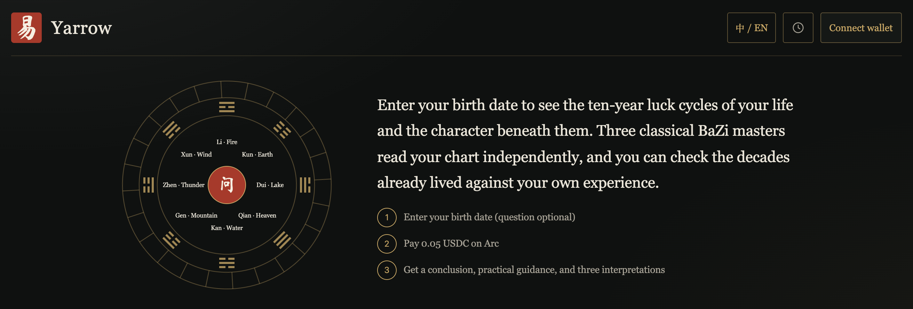
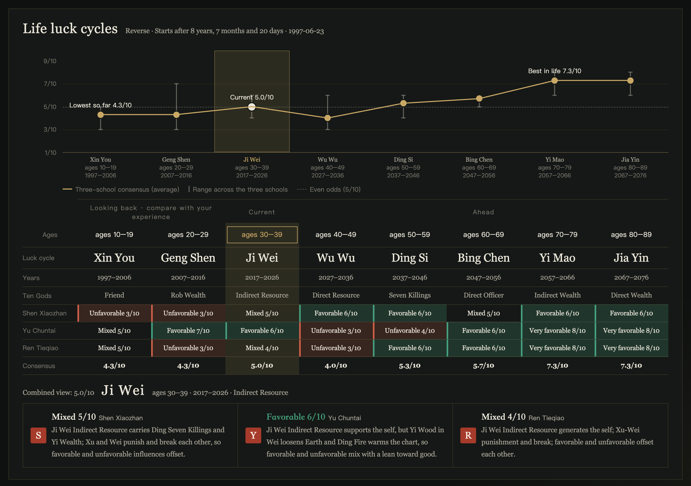
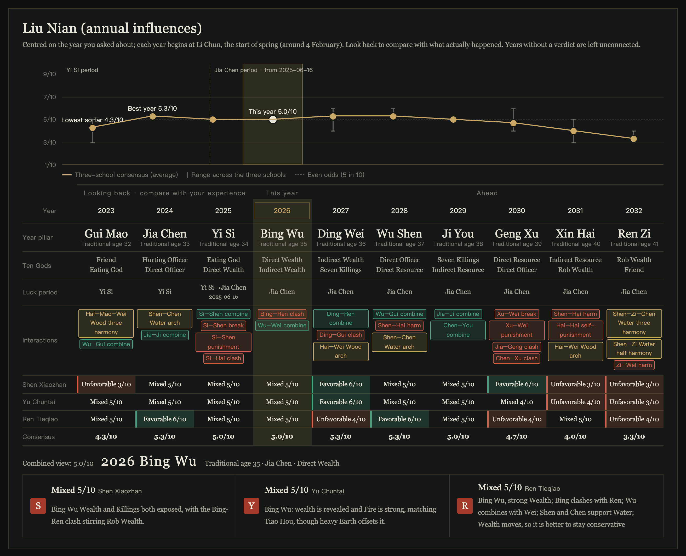
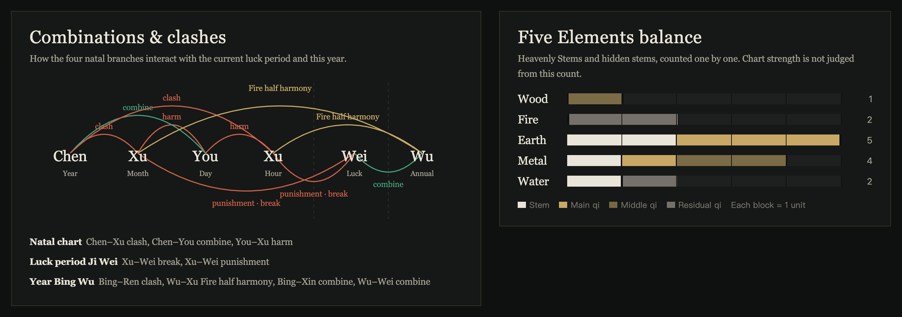
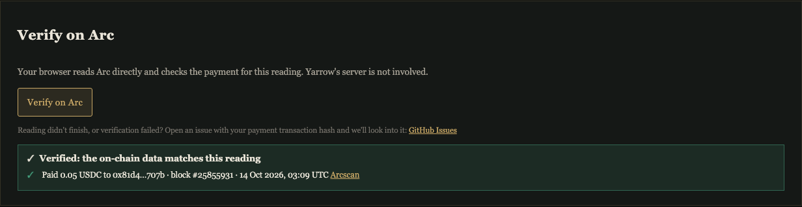
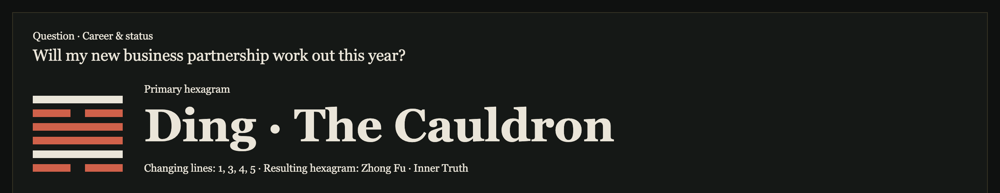
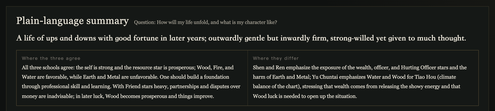
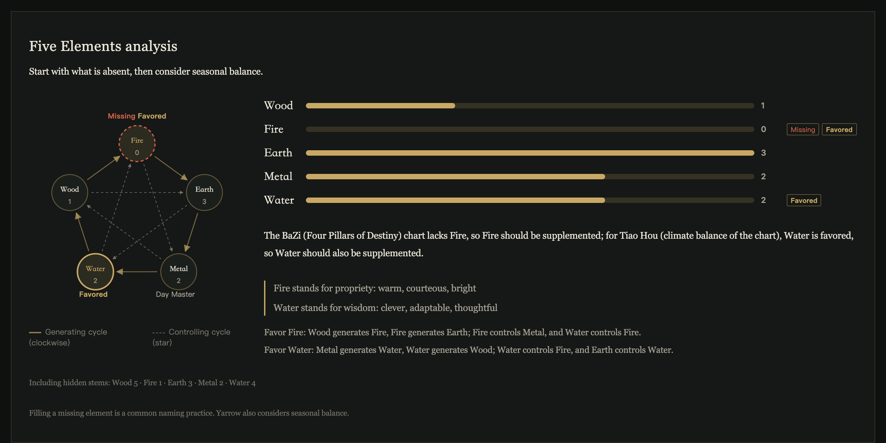
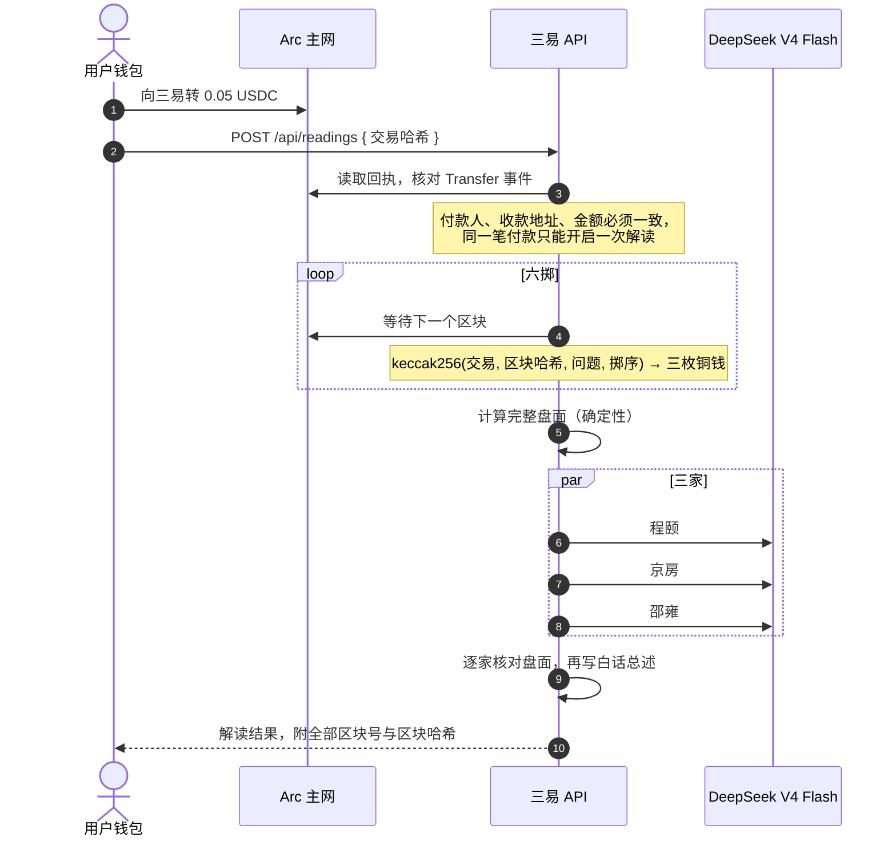
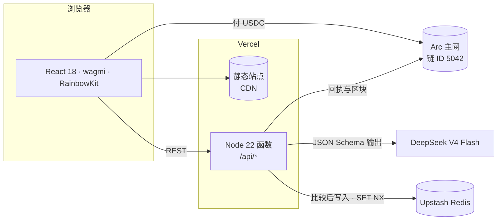

<div align="center">


# 三易 · Yarrow

**三位古代易学名家为你解读命运，Arc 让起卦可以验证。**

*运行在 Arc 主网上的易经与八字应用。每次解读都用 USDC 付费，每个六爻卦都由 Arc 区块哈希起出。*

[](https://yarrow-six.vercel.app)
[](https://yarrow-six.vercel.app)
[](https://yarrow-six.vercel.app)
[](#技术栈)

### [▶ 在线体验：yarrow-six.vercel.app](https://yarrow-six.vercel.app)

[English](README.md) · **中文**



</div>

> 截图为英文界面，网站右上角可以一键切换中英文。

---

## 为什么做三易

三千年来，人们用蓍草或铜钱起卦问易。如今大多数在线占卜应用，要么是随机数生成器配一段文字，要么干脆让大模型编一个答案。

三易的做法不同：

- **🎲 起卦可以验证。** 六爻的每一掷，都由用户在 Arc 上的付款交易和付款之后产生的区块算出。任何人都能复算出同一卦，三易也没法挑选结果。
- **📐 盘面靠计算，不靠编造。** 卦象、纳甲、四柱、大运、五行、黄历、奇门盘全部由确定性代码算出。
- **🏛️ 三位名家，三种方法。** 三个历史流派各自独立解读同一个盘面，用户能看到他们在哪里一致、在哪里有分歧。
- **🔍 每句断语都核对盘面。** 三家断语在展示前要与计算出的盘面逐条核对，盘面不支持的说法会被删去或重写。
- **💬 白话结论和具体建议。** 用现代汉语说清结论，给出可执行的步骤和需要避开的事项。
- **🌏 中英双语。** 中英文界面完整对应。英文解读由通过核对的中文结果翻译而来，传统术语按术语表统一译法。

## 产品一览

<table>
<tr><td colspan="2">

**一生运势。** 八步大运由三位八字名家各自独立评分。折线是三家的共识，误差线表示三家分歧有多大。可以回看已经走过的大运，和自己的经历对照。



</td></tr>
<tr><td colspan="2">

**流年。** 以你所问的年份为中心展开十年，标出每一年与命局之间的刑、冲、合、害。



</td></tr>
<tr><td colspan="2">

**刑冲合害 · 五行分布。** 原局地支与当前大运、流年之间的作用关系，以及天干和藏干的五行分布。



</td></tr>
<tr><td colspan="2">

**在 Arc 上验证。** 一键之下，浏览器直接向 Arc 主网核对付款，不经过三易服务器；问事卦还会用区块哈希复算全部六掷。图为主网首笔付费解读的验证结果。



</td></tr>
<tr><td colspan="2">

**六爻卦象。** 由 Arc 区块起出，标出动爻和变卦。卦辞、爻辞保留中文原文，附英文译文。



</td></tr>
<tr><td colspan="2">

**白话总述。** 先给一句结论，再并排列出三家的共识与分歧。



</td></tr>
<tr><td colspan="2">

**起名。** 先做五行分析，再从五行补益、诗文出处、音义三条路径推荐名字。



</td></tr>
</table>

## 四类解读，九位名家

| 类型 | 需要填写 | 三家 |
|---|---|---|
| **问事** · 六爻 | 一个问题 | **程颐**（义理派）· **京房**（纳甲六爻）· **邵雍**（梅花易数） |
| **命理** · 八字 | 出生日期、时辰、性别 | **沈孝瞻**（格局派）· **余春台**（调候派）· **任铁樵**（扶抑派） |
| **运势** · 八字 | 出生日期，再选今日、本月或某一年 | 同样三位八字名家，聚焦你选的时段 |
| **起名** | 姓氏与偏好 | 五行补益 · 诗文出处 · 音义 |

## 基于 Arc 构建

Arc 在三易里承担两件事：每次解读的**付款**，以及每次六爻起卦的**随机来源**。



- **原生 USDC 付款。** 每次解读 0.05 USDC，走 Arc 的 USDC ERC-20 接口（`0x3600…0000`）。gas 也用 USDC 支付，用户钱包里只需要准备 USDC。
- **服务端不持有私钥。** 后端只读取 Arc 上的数据，核对回执里的 `Transfer` 日志（付款人、收款地址、精确金额），不保存任何私钥。
- **起卦可复算。** 每一掷的计算方式是
  `keccak256("sanyi-throw-v1", 付款交易哈希, 区块哈希, 问题, 掷序)`。
  付款交易和六个区块哈希随解读一起存档，并显示在解读页上，任何人都能复算出同一卦。
- **主网防呆。** 在主网上，如果没有配置收款地址，或者 RPC、浏览器地址指向测试网，服务会拒绝启动。
- **一键链上验证。** 每一卦付费结果都有「在 Arc 上验证」按钮：浏览器直接向 Arc RPC 读取付款回执和六个区块哈希，核对 USDC 转账，并复算六掷，全程不经过三易服务器。

### 为什么选 Arc

- **USDC 就是 gas。** 一卦 0.05 USDC，gas 也用 USDC 付。新用户只需要准备一种资产，不必为了付款再去买一种 gas 币。
- **确定性终局。** Arc 的区块一经产生即为最终状态，不会被回滚替换。用区块哈希起出的卦，事后谁都改不了，包括我们自己。
- **出块快。** 我们在主网实测约每秒两个区块。六掷各等一个付款之后的新区块，整个起卦只需几秒。
- **验证所需的一切都在链上。** 付款回执和区块哈希都公开在 Arc 上，浏览器无须信任三易就能验证一卦。

目前的范围：四类解读（问事、命理与运势、起名）都在 Arc 上付款，并可链上验证付款；问事另外用 Arc 区块抽签。八字与起名由生辰确定性推算，不需要随机数。

### 主网证明

| | |
|---|---|
| 网络 | Arc 主网 · chain ID `5042` · RPC `https://rpc.mainnet.arc.io` |
| USDC（ERC-20 接口） | `0x3600000000000000000000000000000000000000` |
| 收款地址 | [`0x81d48d2c5D0744e8eF7A5c35cDceB0A27A1c707B`](https://explorer.arc.io/address/0x81d48d2c5D0744e8eF7A5c35cDceB0A27A1c707B) |
| 主网首笔付费解读 | [`0x6893ee27…11604073`](https://explorer.arc.io/tx/0x6893ee27689be0982e331e385d9166bde5eb35d15c8eeb435dca85ad11604073) · 区块 25,855,931 · 2026-10-14 03:09 UTC · 0.05 USDC · 八字命理 |

这笔付款在线上生成了一卦完整的解读：三家断语、八步逐运评分与性格画像。由于八字盘面会暴露付款人的生辰，这一卦的链接不公开。线上接口 `GET https://yarrow-six.vercel.app/api/payment` 返回的收款地址、金额与链 ID，就是程序实际校验的值。

### 自己验证一卦

1. 打开任意一卦付费结果，点「在 Arc 上验证」，核对在你的浏览器里直接对 Arc RPC 进行。
2. 也可以手算：从结果页取付款哈希和六个区块号，到 Arc 上读出各区块哈希，计算
   `keccak256(encodePacked("sanyi-throw-v1", 付款交易哈希, 区块哈希, 问题, 掷序))`，
   最低三位即三枚铜钱（1 为背、0 为字）。每个起卦区块都必须晚于付款区块。

## 架构



- **响应返回后继续执行。** 起卦、三家落笔、盘面核对和翻译交给 Vercel 的 `waitUntil` 继续运行，最长 300 秒，浏览器轮询进度。
- **并发安全的存储。** Redis 上用原子的比较后写入（Lua 脚本）更新存档，付款认领用 `SET NX`。多个函数实例同时运行时，不会互相覆盖，也不会让同一笔付款被用两次。
- **单个打包函数。** 由 `scripts/build-vercel.ts` 通过 Vercel Build Output API 部署，源码和配置文件不会被公开访问。

## 技术栈

| 层 | 技术 |
|---|---|
| 链 | Arc 主网 · USDC（ERC-20 接口）· viem |
| 钱包 | wagmi · RainbowKit |
| 前端 | React 18 · esbuild · 手绘 SVG 图表 |
| 后端 | TypeScript（strict）· Node 22 · Vercel Functions |
| 历法计算 | lunar-javascript · 自研纳甲、奇门、五行与刑冲合害表 |
| 模型 | DeepSeek `deepseek-v4-flash`，用 JSON Schema 约束输出 |
| 存储 | 生产环境用 Upstash Redis，本地用 JSON 文件 |
| 质量 | 847 个测试（`node:test`）· `tsc --noEmit` |

## 面向 AI agent

agent 不需要浏览器、也不需要账号就能买一卦，三易依然不持有任何私钥：

1. 不带付款，直接 `POST /api/readings`。有效请求会得到 **HTTP 402**，附价格、代币、收款地址与链 ID。
2. 在 Arc 上用 ERC-20 `transfer` 付 0.05 USDC，gas 同样用 USDC 付。
3. 带上 `feeProof: { payer, transactionHash }` 重新提交同一请求，再轮询 `GET /api/readings/{id}`。

无效请求会先返回 400，不会让 agent 白付钱；付款只在一卦认领它时才算用掉。完整说明见 [`/llms.txt`](https://yarrow-six.vercel.app/llms.txt)。[`scripts/agent-reading.ts`](scripts/agent-reading.ts) 用 viem 跑通全流程：读 402、链上付款、认领、轮询。

```bash
AGENT_PRIVATE_KEY=0x… node --import tsx scripts/agent-reading.ts https://yarrow-six.vercel.app "Will my new business partnership work out this year?"
```

这是 HTTP 402 付款发现，不是完整的 x402 协议。三易从不代人提交签名转账，因此不需要私钥。

## 下一步

以下是规划中的事项，尚未实现：

- **完整的 x402。** 三易已经能返回 402、接受链上付款（见上一节）；下一步是通过 facilitator 接受 x402 签名的 USDC 授权，agent 无须自己提交转账。
- **过去的运「准不准」。** 用户给已经走过的每步大运标注准或不准，我们由此得到真实的准确度信号，也有数据来改进三家的提示词。
- **分享卡片。** 一键生成性格画像与一生运势的图片，不含生辰。
- **合婚。** 同样由三家合看两个人的八字。
- **更轻的首屏。** 钱包相关的库等到用户准备付款时再加载。

## 本地运行

```bash
npm ci
cp .env.example .env    # 填入 DEEPSEEK_API_KEY 与 WALLETCONNECT_PROJECT_ID
npm run frontend:dev    # http://127.0.0.1:4173（默认使用 Arc 测试网）

npm run typecheck && npm test
```

### 自行部署

1. 在 Vercel 导入本仓库。`vercel.json` 已配置好构建命令。
2. 在 **Storage** 里添加 **Upstash Redis**，它会自动注入 `KV_REST_API_URL` 和 `KV_REST_API_TOKEN`。
3. 添加下表的环境变量，然后重新部署。

| 变量 | 值 |
|---|---|
| `ARC_CHAIN_ID` | `5042`（Arc 主网） |
| `SANYI_FEE_RECIPIENT` | 接收卦金的地址 |
| `DEEPSEEK_API_KEY` | DeepSeek 的 API key |
| `WALLETCONNECT_PROJECT_ID` | Reown 的公开项目 ID，RainbowKit 要求必填 |

## 目录结构

```
web/                 React 前端、图表、中英文词典
src/sanyi/           解读服务、九家、盘面核对、收费、存储
src/calendar/        黄历、八字、大运、奇门、历法换算
src/oracle/          卦象与纳甲排盘
src/vercel/api.ts    Vercel 函数入口
openspec/            规范与变更记录
```

<sub>`contracts/`、`reports/`、`docs/legacy/` 来自早期的测试网原型（[说明](docs/legacy/arc-testnet-feasibility.md)），线上应用不使用这些内容。</sub>

---

<div align="center">
<sub>仅供参考与自省，不构成医疗、法律或投资建议。</sub>
</div>
